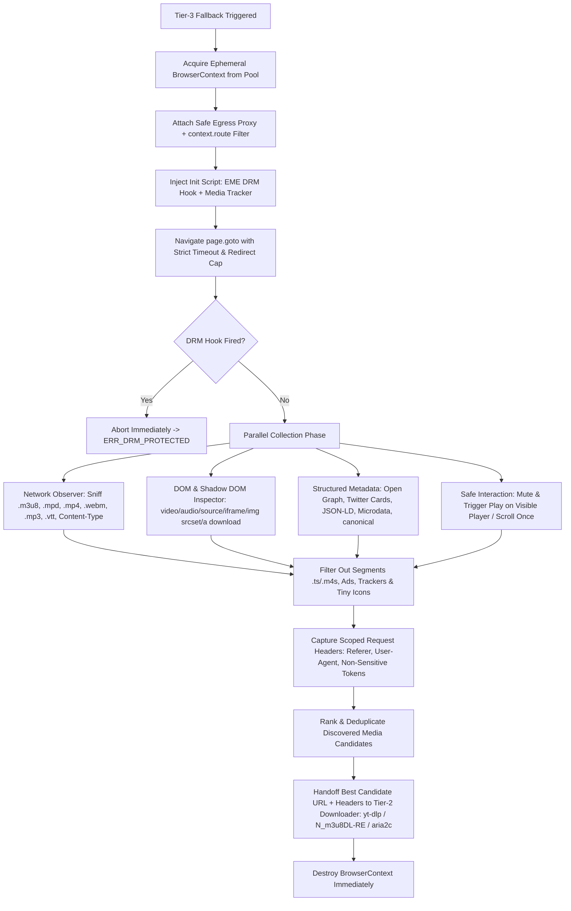

# 03 — Content Coverage Matrix & Browser Fallback Architecture

---

## 1. Content Category Coverage Matrix

Every URL submitted to a Universal Media Extraction Engine falls into one of four operational classes:
- **Direct Extraction:** Reliably extracted via HTTP inspection or specialized CLI extractors (`yt-dlp`, `gallery-dl`, `Streamlink`, `N_m3u8DL-RE`, `Trafilatura`) with no headless browser.
- **Browser Rendering Required:** Target relies on client-side SPA hydration, dynamic XHR/Fetch manifest loading, or custom JS video players where static HTML lacks media URLs.
- **Authentication Required:** Content is technically extractable by our engines, but **only when the user supplies valid session credentials/cookies/OAuth tokens** (never via circumvention).
- **Unsupported / Out of Scope:** Content protected by DRM (Widevine, FairPlay, PlayReady, Marlin), hard paywalls, private/inaccessible accounts without user auth, or anti-bot CAPTCHAs.

| # | Content Category | Primary Engine(s) | Fallback Engine(s) | Extraction Class | Reliability | Key Edge Cases & Limits |
|---|---|---|---|---|---|---|
| 1 | **Video (VOD)** | `yt-dlp` (+ Deno/EJS + `curl_cffi`) | `Playwright` → `yt-dlp`/`FFmpeg` | Direct (90%+) / Browser (10%) | **Very High (95%+)** | Datacenter IP blocks on YouTube/TikTok/IG; requires Deno + EJS + optional PO tokens or clean egress IPs. |
| 2 | **Audio (Tracks, Podcasts, SoundCloud, Bandcamp)** | `yt-dlp`, `direct-http` | `Playwright` → `FFmpeg` audio extract | Direct | **Very High (95%+)** | Spotify/Apple Music audio streams are DRM-protected (unsupported directly; only public preview/metadata available). |
| 3 | **Video Playlists & Channels** | `yt-dlp` (`--flat-playlist`) | None | Direct | **High (90%)** | Must enforce strict `max_items` cap and paginated lazy enumeration (`--flat-playlist`) to avoid multi-minute hangs on 10k-video channels. |
| 4 | **Single Images** | `direct-http`, `gallery-dl` | `Playwright` (DOM ``/`srcset` + OG) | Direct | **Very High (98%)** | Hotlink `Referer` headers required on some CDNs; check `Content-Type` + magic bytes (prevent SVG XSS). |
| 5 | **Image Galleries & Albums** | `gallery-dl` | `Playwright` (limited DOM scan) | Direct (supported sites) / Auth (IG/Pixiv) | **High (85–90%)** | Instagram/X/Pixiv frequently require user cookies for full albums or pagination; enforce per-job item/size limits. |
| 6 | **Public Social Media Posts** (X, Reddit, Bluesky, TikTok, IG Reels, Threads) | `yt-dlp` (video) + `gallery-dl` (images/carousels) | `Playwright` (Threads / JS embeds) | Direct / Auth-sensitive | **Medium-High (75–85%)** | Highest churn category: platforms aggressively gate anonymous views (Instagram login walls, X NSFW/age-gated posts, Facebook private groups). |
| 7 | **Direct Downloadable Files** (`.zip`, `.mp4`, `.mp3`, `.iso`, `.tar.gz`, etc.) | `direct-http` (`HEAD`) → `aria2c` | None | Direct | **Very High (99%)** | Validate `Content-Length` against quota before downloading; handle signed expiring URLs and `Content-Disposition` filenames safely. |
| 8 | **PDF & Document Links** (`.pdf`, `.epub`, `.docx`, `.csv`, `.pptx`) | `direct-http` → `aria2c` | `Playwright` (if behind JS download redirect) | Direct | **Very High (98%)** | Check magic bytes (`%PDF-`) in case server returns an HTML login/interstitial page with `200 OK`. |
| 9 | **HLS Streams (`.m3u8`)** | `N_m3u8DL-RE` or `yt-dlp` | `FFmpeg` (only after manifest validation) | Direct | **High (90%)** | Clear-key / unencrypted HLS & standard AES-128 with public key URL work reliably. **SAMPLE-AES / FairPlay / Widevine DRM = Unsupported.** |
| 10 | **DASH Streams (`.mpd`)** | `N_m3u8DL-RE` or `yt-dlp` | `Streamlink` (`dash://`) | Direct | **High (85–90%)** | Unencrypted DASH (separate video+audio muxed by FFmpeg) works well. `<ContentProtection>` with CENC/Widevine/PlayReady = **Unsupported (DRM).** |
| 11 | **Live Streams** (Twitch, YouTube Live, Kick, HLS/DASH Live) | `Streamlink` | `yt-dlp --live-from-start`, `N_m3u8DL-RE` | Direct | **High (85%)** | Requires hard `max_duration` (e.g., 30–60 min) and `max_bytes` cutoffs on server workers; Twitch pre-roll ads can cause brief stalls. |
| 12 | **Public Webpages** (Articles, Blogs, Landing Pages) | `Trafilatura` + `direct-http` | `Playwright` (for CSR/SPA pages) | Direct / Browser | **Very High (95%)** | Extract canonical URL, title, author, date, clean Markdown/text, OG image, JSON-LD schema, and embedded media links. |
| 13 | **Embedded Video Players** (iframes: Vimeo, JWPlayer, Video.js, Plyr, BunnyCDN, Wistia) | `yt-dlp` (built-in iframe/embed parser) | `Playwright` (iframe + network manifest sniff) | Direct / Browser | **High (80–85%)** | Domain-restricted embeds (e.g., Vimeo private embed) require forwarding the parent page's `Referer` header. |
| 14 | **JavaScript-Rendered Media** (React/Next/Vue SPAs, lazy-loaded players) | `Playwright` (network + DOM sniffer) | Handoff discovered URL to `yt-dlp` / `N_m3u8DL-RE` / `aria2c` | **Browser Required** | **Medium-High (75–80%)** | High CPU/RAM cost; fails if player requires CAPTCHA, login, or EME DRM. |
| 15 | **Metadata** (Title, Author, Views, Tags, Duration, Dimensions, EXIF) | `yt-dlp`, `gallery-dl`, `Trafilatura`, `ffprobe` | `Playwright` (OG + JSON-LD + `<meta>`) | Direct | **Very High (98%)** | Always available fastest via non-downloading probe; enriched post-download via `ffprobe`. |
| 16 | **Captions & Subtitles** (`.vtt`, `.srt`, `.ttml`, `.ass`) | `yt-dlp` (`--write-subs --write-auto-subs`) | `Playwright` (sniff `.vtt`/`.srt` XHRs) | Direct | **High (90%)** | Normalize all tracks into structured `subtitles[]` with ISO-639 language codes and `is_auto_generated` flag. |
| 17 | **Transcripts (Publicly Available)** | `yt-dlp` (subtitles → plain/timestamped text normalization) | `Trafilatura` (podcast/article transcripts) | Direct | **High (85–90%)** | Derived cleanly from public VTT/SRT/JSON3 tracks without incurring ASR/Whisper GPU cost (optional paid Whisper tier later). |

### Explicit Content Boundaries (What We Will NOT Support)
- **DRM-Protected Media:** Netflix, Disney+, Prime Video, Spotify full streams, Widevine/PlayReady/FairPlay EME streams, HLS `METHOD=SAMPLE-AES` with DRM key servers. Detect early (via `<ContentProtection>`, `#EXT-X-KEY`, or `navigator.requestMediaKeySystemAccess` hook) and return structured error `ERR_DRM_PROTECTED`.
- **Paywalls & Unauthorized Private Content:** No paywall bypassing, no credential stuffing, no scraping behind login walls without explicit user-supplied session credentials/OAuth.
- **Anti-Bot / CAPTCHA Solving:** No automated CAPTCHA bypass or solver services; return `ERR_CHALLENGE_REQUIRED` cleanly.

---

## 2. Browser Extraction Fallback Architecture (Playwright)

### 2.1 When the Browser Tier Is Triggered
Headless browsers consume **150–400 MB RAM and 5–15 seconds** per page—10–30x heavier than HTTP/CLI extractors. Therefore, Playwright is strictly a **Tier-3 Escalation Engine**, invoked ONLY when:
1. Tier-1 (`direct-http` + static HTML parser) confirms an `text/html` response (not a direct binary), AND
2. Tier-2 (`yt-dlp`, `gallery-dl`, `Streamlink`) either have no matching extractor or return `UnsupportedError` / zero media, AND
3. Static HTML heuristics indicate a JS-rendered shell (e.g., empty `
`, `<noscript>Enable JavaScript</noscript>`, known player scripts like `hls.js`/`dash.js`/`video.js`/`jwplayer`, or embedded `<iframe>` players), AND
4. Caller policy/tier permits browser fallback (rate-limited separately from lightweight probes).

### 2.2 Browser Fallback Extraction Pipeline

### 2.3 Key Capabilities Implemented in the Browser Adapter

1. **Network Request & Response Observation (Highest Yield):**
   - Listen to `page.on("request")` and `page.on("response")`.
   - Classify candidates by both **MIME type** and **URL pattern**:
     - **Manifests (Priority 1):** `application/vnd.apple.mpegurl`, `application/x-mpegurl`, `application/dash+xml`, `.m3u8`, `.mpd`. Capture the manifest URL, exact `Referer`/`Origin`/`User-Agent` headers, and optionally parse the response text to inspect resolution variants and detect DRM tags (`#EXT-X-KEY:METHOD=SAMPLE-AES`, `<ContentProtection>`).
     - **Progressive Media (Priority 2):** `video/*`, `audio/*` responses with `Content-Length >= 100 KB` (excluding `206` tiny probe ranges or ads).
     - **Subtitle Tracks (Priority 3):** `text/vtt`, `.vtt`, `.srt`, `.ttml`.
     - **Explicit Segment Exclusion (Borrowed from `S-k404/grab`):** Ignore raw chunks (`.ts`, `.m4s`, `.cmfv`, `.cmfa`, `init.mp4`, `?bytestart=`) so the user gets the master manifest rather than 400 broken 2-second fragments.
2. **Resource Interception for Speed & Safety (`context.route`):**
   - **Block non-essential bloat:** Abort `font`, `stylesheet` (optional if layout needed for play button), `beacon`, analytics, and known ad domains to cut load time by 50–70%.
   - **Block dangerous schemes:** Allow strictly `http://` and `https://`; immediately abort `file://`, `ftp://`, `chrome://`, `javascript:` navigations, `ws://` to private hosts.
   - **Enforce Redirect Caps:** Track `request.redirectedFrom()` chain depth (max 5 hops).
3. **DOM, Shadow DOM & Iframe Inspection:**
   - Traverse `document`, open `shadowRoot` trees, and same/cross-origin child `page.frames()` (Playwright natively exposes cross-origin iframes via `frame.evaluate()`!).
   - Inspect `<video>` / `<audio>` (`currentSrc`, `src`, `<source>`), `<a download>` links, `<picture>`/`` (picking highest width descriptor for images), and embedded player config blobs (`__NEXT_DATA__`, `__INITIAL_STATE__`, `window.playerConfig`).
4. **HTML Metadata, Open Graph & JSON-LD Extraction:**
   - Extract `og:title`, `og:description`, `og:image`, `og:video`, `og:audio`, `og:type`, `twitter:*`, `<link rel="canonical">`, and `<script type="application/ld+json">` (`VideoObject`, `AudioObject`, `ImageObject`, `NewsArticle`, `PodcastEpisode`).
   - Often `JSON-LD` `VideoObject.contentUrl` or `embedUrl` reveals the clean direct MP4/manifest URL even without clicking play!
5. **Proactive EME DRM Detection (Borrowed from `S-k404/grab`):**
   - Inject `context.add_init_script()` wrapping `navigator.requestMediaKeySystemAccess` to record any DRM key-system request (Widevine, FairPlay, PlayReady). If triggered, immediately classify the item as `ERR_DRM_PROTECTED` instead of waiting for timeouts or downloading unusable encrypted segments.
6. **Codec Limitation Mitigation:**
   - Playwright's bundled open-source Chromium lacks proprietary H.264/AAC decoders, which can cause some MSE players (`hls.js`/`shaka-player`) to abort before requesting the manifest if `MediaSource.isTypeSupported('video/mp4; codecs="avc1..."')` returns `false`.
   - **Fix:** Either run Playwright with `channel="chrome"` (official Chrome for Testing / Google Chrome binary in the isolated browser worker image) OR stub capability checks only for manifest discovery, then hand the discovered `.m3u8`/`.mpd` URL off to `N_m3u8DL-RE`/`yt-dlp`/`FFmpeg` for actual downloading!

### 2.4 Explicit Limits of the Browser Fallback
- **Never handles downloads inside the browser:** The browser is strictly a **discovery/extraction sensor**. Once a media or manifest URL (+ `Referer`/headers) is discovered, the browser context is torn down and the actual multi-hundred-megabyte transfer is performed by `yt-dlp`, `N_m3u8DL-RE`, or `aria2c`.
- **Blob URLs (`blob:https://...`):** MSE players set `video.src = "blob:..."`. You cannot fetch a `blob:` URL externally—you **must** rely on network interception to catch the underlying `.m3u8`/`.mpd` manifest or XHR media URL that feeds the `MediaSource` buffer.
- **Cannot bypass DRM, paywalls, CAPTCHAs, or private auth:** If a page renders a login wall, Cloudflare Turnstile/CAPTCHA, or EME DRM stream, the adapter returns a clean structured error code (`ERR_AUTH_REQUIRED`, `ERR_CHALLENGE_REQUIRED`, `ERR_DRM_PROTECTED`) rather than attempting evasion.
- **Resource & Latency Ceiling:** Enforce a strict 15–20 second page budget, max 2–4 concurrent contexts per browser pod, and hard browser process recycling every ~50–100 pages to eliminate Chromium memory leaks.
