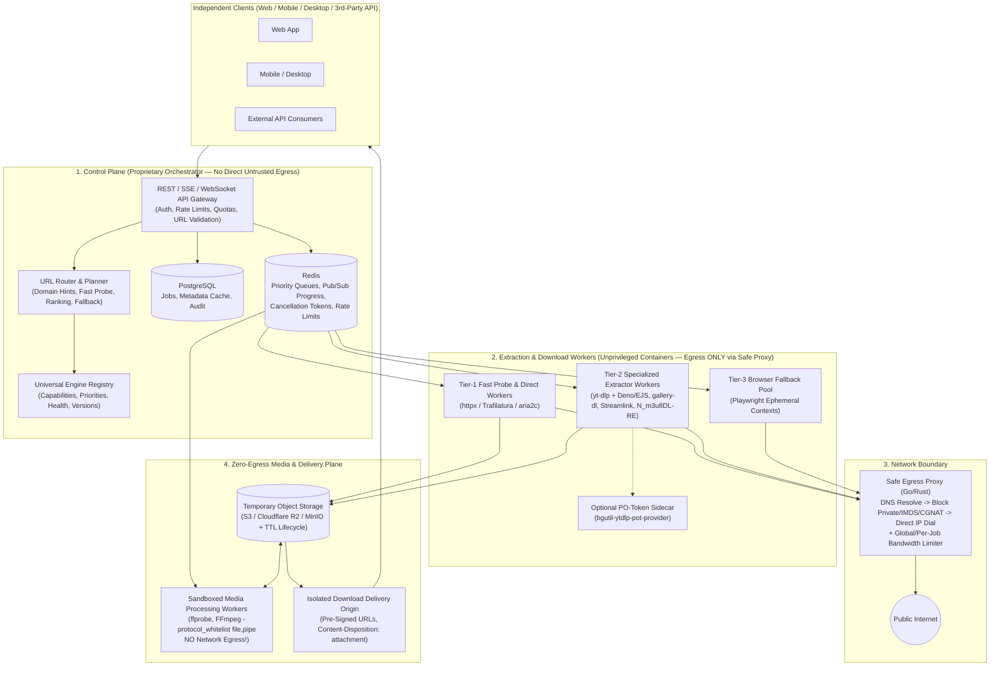

# 04 — System Architecture, Universal Engine Registry & Processing Pipeline

---

## 1. Proposed High-Level System Architecture

The system is intentionally split into **four isolated planes** so that frontends (web, mobile, desktop, public API), orchestration logic, untrusted network extraction, and untrusted binary media processing never share blast radius or tight coupling:



---

## 2. Universal Engine Registry Design

The **Engine Registry** decouples the rest of the platform from every underlying extractor. Adding `N_m3u8DL-RE`, replacing `aria2`, or swapping `yt-dlp` requires **zero changes** to API endpoints, frontends, or downstream consumers.

### 2.1 Engine Descriptor Schema
Full machine-readable JSON Schema: [`schemas/engine-manifest.schema.json`](schemas/engine-manifest.schema.json)

Every adapter registers an immutable capability manifest at worker startup and updates live health telemetry periodically:

```typescript
export type EngineCapability =
  | "extract_metadata"
  | "enumerate_formats"
  | "extract_media_url"
  | "download_media"
  | "download_direct_file"
  | "download_gallery"
  | "download_playlist"
  | "extract_subtitles"
  | "extract_thumbnail"
  | "extract_audio"
  | "process_media"
  | "record_livestream"
  | "render_javascript"
  | "support_authenticated_content";

export interface EngineManifest {
  id: string;                        // e.g. "yt-dlp", "gallery-dl", "streamlink", "aria2", "playwright"
  name: string;                      // Human-readable display name
  version: string;                   // Live probed binary/package version (e.g. "2026.10.26")
  tier: 1 | 2 | 3;                   // 1=Fast HTTP/Direct, 2=Specialized CLI, 3=Headless Browser
  supported_content_types: string[]; // ["video", "audio", "playlist", "hls", "dash", ...]
  supported_domains: {
    mode: "allowlist" | "pattern_list" | "wildcard";
    domains?: string[];              // Exact or suffix matches for O(1) routing
    exclude_domains?: string[];      // Known unsupported domains to skip fast
    site_count?: number;             // Informational (e.g., 1800)
  };
  protocols: string[];               // ["http", "https", "hls", "dash", "rtmp"]
  capabilities: EngineCapability[];
  auth_requirements: {
    supports_cookies: boolean;
    supports_oauth: boolean;
    supports_headers: boolean;
    required_for_domains?: string[]; // e.g. ["pixiv.net", "instagram.com"]
  };
  cost_profile: {
    avg_probe_ms: number;            // Used by router to avoid wasteful calls
    memory_mb: number;
    requires_browser: boolean;
  };
  priority: number;                  // Base priority (0–1000) within its content category
  installation_status: "installed" | "missing" | "misconfigured";
  health_status: {
    state: "healthy" | "degraded" | "circuit_open" | "unavailable";
    last_checked_at: string;
    consecutive_failures: number;
    error_rate_5m: number;
    outdated_detected: boolean;      // Triggered by signature/nsig failure heuristics
  };
  license: string;                   // SPDX identifier tracked for compliance audit
  invocation_mode: "subprocess" | "http_sidecar" | "in_process";
}
```

### 2.2 Common Engine Adapter Interface

Every engine implements the exact same abstract contract (`ExtractorAdapter` / `ProcessorAdapter`):

```python
from abc import ABC, abstractmethod
from typing import AsyncIterator

class ExtractorAdapter(ABC):
    @abstractmethod
    def manifest(self) -> EngineManifest:
        """Return static capabilities + dynamic version/health."""

    @abstractmethod
    def quick_match(self, ctx: UrlContext) -> MatchScore:
        """
        Zero-network heuristic check (<1ms) using URL host, path extension,
        pre-fetched HTTP HEAD Content-Type, and known domain tables.
        Returns confidence 0..100 + reason.
        """

    @abstractmethod
    async def probe(self, ctx: UrlContext, options: ProbeOptions) -> NormalizedMediaResult:
        """
        Non-downloading metadata & format enumeration.
        Must honor timeout, cancellation token, and Safe Egress Proxy.
        """

    @abstractmethod
    async def download(
        self,
        ctx: UrlContext,
        plan: DownloadPlan,
        progress_cb: ProgressCallback,
        cancel_token: CancellationToken,
    ) -> DownloadArtifactResult:
        """
        Execute bounded download into an isolated job scratch directory.
        Emits structured ProgressEvent updates; kills entire process group on cancel.
        """

    @abstractmethod
    async def health_check(self) -> HealthReport:
        """Verify binary presence, runtime deps (e.g. Deno, FFmpeg), and version."""
```

### 2.3 Registered Engine Priority Map

| Engine ID | Tier | Invocation | Key Capabilities | Default Priority |
|---|---|---|---|---:|
| `direct-http` | 1 | In-process (`httpx`) | `extract_metadata`, `download_direct_file` (small files & `HEAD` probe) | 950 (direct binaries/PDFs) |
| `trafilatura` | 1 | In-process | `extract_metadata` (static HTML/OG/JSON-LD/article text) | 800 (webpages) |
| `aria2` | 1 | Subprocess (`aria2c`) | `download_direct_file` (large direct binaries >10 MB) | 900 (large direct files) |
| `yt-dlp` | 2 | Subprocess (`yt-dlp`) | `extract_metadata`, `enumerate_formats`, `extract_media_url`, `download_media`, `download_playlist`, `extract_subtitles`, `extract_thumbnail`, `extract_audio`, `support_authenticated_content` | 900 (video/audio/playlists) |
| `gallery-dl` | 2 | Subprocess (`gallery-dl`) | `extract_metadata`, `extract_media_url`, `download_gallery`, `support_authenticated_content` | 880 (image/gallery domains) |
| `streamlink` | 2 | Subprocess (`streamlink`) | `extract_metadata`, `enumerate_formats`, `extract_media_url`, `record_livestream` | 920 (live stream domains) |
| `n-m3u8dl-re` | 2 | Subprocess (`N_m3u8DL-RE`) | `download_media`, `record_livestream` (raw `.m3u8`/`.mpd`/`.ism`) | 910 (direct manifests) |
| `playwright` | 3 | Isolated Browser Pool | `render_javascript`, `extract_metadata`, `extract_media_url`, `extract_thumbnail` | 300 (escalation fallback only) |
| `ffmpeg` | Post | Zero-Egress Subprocess | `process_media`, `extract_audio`, `extract_thumbnail` (`ffprobe` validation) | 1000 (post-processing) |

---

## 3. URL Processing Pipeline & Smart Routing Algorithm

### 3.1 End-to-End 11-Stage Pipeline

```
1. URL Submitted
   │  (Input sanitization, length cap <= 4096 chars, idempotency key, user quota check)
   ▼
2. URL Validation & Canonicalization
   │  (Strict http/https scheme, strip tracking params, normalize youtu.be/x.com/pin.it,
   │   pre-check literal IP deny-list; check Redis metadata cache for recent probe)
   ▼
3. Domain & Lightweight Content Identification (Tier-1 Fast Pass)
   │  • Check O(1) compiled domain routing table (e.g., youtube.com -> yt-dlp,
   │    pixiv.net -> gallery-dl, twitch.tv -> streamlink/yt-dlp).
   │  • If unknown domain or ambiguous path: issue ONE safe HTTP HEAD / 64 KB GET
   │    through Safe Egress Proxy to inspect final redirect URL, HTTP status,
   │    Content-Type, Content-Length, and Content-Disposition.
   ▼
4. Candidate Engine Selection & Capability Comparison
   │  • Filter Engine Registry by: healthy + installed + supports(content_type, requested_capabilities).
   │  • Compute composite score:
   │      score = quick_match_confidence * 0.50
   │            + base_priority_norm     * 0.25
   │            + health_reliability     * 0.15
   │            - cost_latency_penalty   * 0.10
   │  • Produce ordered candidate list [E1, E2, E3] (never blindly fan out all engines!).
   ▼
5. Metadata & Format Extraction (Non-Downloading Probe)
   │  • Invoke top candidate E1.probe() with strict timeout (e.g., 15–25s).
   │  • yt-dlp: `--dump-single-json --skip-download --flat-playlist --playlist-end 50`
   │  • gallery-dl: `--dump-json --range 1-50`
   │  • streamlink: `--json`
   │  • direct-http: HEAD + HTML `<meta>`/OG/JSON-LD parse (no extra fetch!)
   │  • Return normalized preview to client OR continue to download if auto-download requested.
   ▼
6. Fallback Escalation (Only on Retryable / Unsupported Outcome)
   │  • HARD STOP (do NOT escalate) on: ERR_DRM_PROTECTED, ERR_AUTH_REQUIRED,
   │    ERR_NOT_FOUND (404/410), ERR_GEO_BLOCKED, ERR_QUOTA_EXCEEDED, ERR_SSRF_BLOCKED.
   │  • ESCALATE to E2 (e.g., yt-dlp found no video on an X/Reddit/IG post -> try gallery-dl).
   │  • ESCALATE to Tier-3 Playwright ONLY if response was HTML, Tier-2 found 0 media,
   │    and page shows JS/player indicators. If Playwright sniffs a manifest/MP4 URL,
   │    hand that URL back to Tier-2 downloader (`N_m3u8DL-RE`/`yt-dlp`/`aria2c`).
   ▼
7. Execution Planning & Pre-Flight Quota Check
   │  • Resolve requested format/quality/audio/subtitle/clip options.
   │  • Verify estimated size <= max_job_bytes and free scratch disk >= min_free_disk_floor.
   ▼
8. Bounded Download Execution
   │  • Allocate ephemeral per-job directory (`/scratch/jobs/<job_uuid>`).
   │  • Execute selected downloader via Safe Egress Proxy with live progress events -> Redis Pub/Sub.
   │  • Support instant cancellation via process-group `SIGTERM` -> `SIGKILL`.
   ▼
9. Validation & Optional Post-Processing (Zero-Egress Media Worker)
   │  • Validate file magic bytes + `ffprobe` (confirm real container/codec, reject polyglots/HTML error pages).
   │  • Run optional FFmpeg pipeline (`-protocol_whitelist file,pipe`): remux, audio extract,
   │    transcode, clip (`-ss`/`-to`), thumbnail extraction, subtitle embed.
   │  • Compute SHA-256 content hash for deduplication & integrity.
   ▼
10. Normalized Output Assembly
   │  • Map engine-specific output into canonical `NormalizedMediaOutput` JSON schema.
   │  • Attach warnings, timings, provenance (`engine_used`, `fallback_chain`), and artifact descriptors.
   ▼
11. Storage & Safe Delivery
   │  • Upload artifact(s) + thumbnails + subtitles to temporary Object Storage (S3/R2/MinIO) with TTL.
   │  • Purge local job scratch directory immediately.
   │  • Return short-lived pre-signed download URLs on an isolated download subdomain with
   │    `Content-Disposition: attachment; filename="..."` and `X-Content-Type-Options: nosniff`.
```

### 3.2 Avoiding Wasteful Repeated Calls
- **Probing Cache:** Cache normalized `probe()` results in Redis keyed by `sha256(canonical_url + auth_context_hash)` for 5–15 minutes (short TTL because signed CDN stream URLs expire quickly; separate metadata cache TTL of 1 hour from stream URL TTL of 5 minutes).
- **Single-Pass Ambiguous Social Routing:** On hybrid sites (Twitter/X, Reddit, Instagram, Bluesky) that host *either* video *or* image galleries, check `yt-dlp` first ONLY when user asks for video/auto; if `yt-dlp` returns `"No video formats found"`, immediately hand off to `gallery-dl` without re-probing `streamlink` or `aria2`.
- **Circuit Breakers per `(Engine, Domain)`:** If `yt-dlp` fails with 429/bot-block >60% over a 5-minute window on a specific domain, open a domain-scoped circuit breaker, emit an alert (checking for outdated extractor signatures like `"nsig"`/`"challenge solving"`), and fail fast instead of burning worker threads.

### 3.3 Retry Policy, Concurrency, Cancellation & Progress
- **Retry Policy:**
  - *Retryable (exponential backoff with jitter, max 2–3 retries):* HTTP `429`, `502`, `503`, `504`, transient TLS/socket reset, partial segment timeout.
  - *Non-Retryable (fail immediately):* `400`, `401`, `403` (auth/DRM/geo), `404`, `410`, SSRF violation, disk/size quota exceeded, DRM detected.
- **Concurrency:** Separate worker pools & Redis queues by resource profile so heavy jobs never starve fast probes:
  - `q:probe` (high concurrency, 15–25s timeout)
  - `q:download` (bounded concurrency, 15–30m timeout, disk-aware)
  - `q:browser` (low concurrency, 2–4 contexts/pod, 20s timeout)
  - `q:media` (CPU-bound FFmpeg pool, zero network egress)
- **Job Cancellation:** Store `cancel:<job_id>` flag in Redis + publish on `ctrl:<job_id>`. Worker listens asynchronously, immediately sends `SIGTERM` → (3s grace) → `SIGKILL` to the subprocess's entire OS process group (`os.killpg`), and deletes partial scratch files.
- **Progress Reporting:** Adapters parse stdout/stderr structured progress lines (e.g., `yt-dlp --progress-template`, `aria2c --summary-interval=1`, `ffmpeg -progress pipe:1`) into a uniform `ProgressEvent` (`stage`, `percent`, `bytes_downloaded`, `bytes_total`, `speed_bps`, `eta_seconds`, `items_completed`, `items_total`), throttled to ≤2 updates/sec via Redis Pub/Sub → SSE/WebSocket to clients.

---

## 4. Normalized Output Schema

Regardless of whether `yt-dlp`, `gallery-dl`, `Streamlink`, `aria2`, `Trafilatura`, or `Playwright` handled the URL, the API returns a single consistent schema.

- **Full JSON Schema (Draft 2020-12):** [`schemas/normalized-media-output.schema.json`](schemas/normalized-media-output.schema.json)
- **Full Realistic Example Payload:** [`schemas/example-normalized-output.json`](schemas/example-normalized-output.json)

### Abbreviated Example Structure

```json
{
  "schema_version": "1.0.0",
  "job_id": "job_01JFX9K2M8R4V7N2Q5W8Z1C3B6",
  "original_url": "https://youtu.be/dQw4w9WgXcQ?si=tracking123",
  "url": "https://www.youtube.com/watch?v=dQw4w9WgXcQ",
  "source": {
    "domain": "youtube.com",
    "platform": "youtube",
    "extractor_key": "Youtube",
    "external_id": "dQw4w9WgXcQ"
  },
  "content_type": "video",
  "is_live": false,
  "title": "Sample High-Definition Reference Video",
  "description": "Official video description...",
  "thumbnail": {
    "url": "https://i.ytimg.com/vi/dQw4w9WgXcQ/maxresdefault.jpg",
    "width": 1280,
    "height": 720,
    "mime_type": "image/jpeg"
  },
  "duration_seconds": 212.4,
  "size_bytes": 48291044,
  "author": {
    "name": "Example Channel",
    "id": "UC_example_123",
    "url": "https://www.youtube.com/@example"
  },
  "available_formats": [
    {
      "format_id": "137+140",
      "container": "mp4",
      "mime_type": "video/mp4",
      "resolution": "1920x1080",
      "width": 1920,
      "height": 1080,
      "fps": 30,
      "video_codec": "avc1.640028",
      "audio_codec": "mp4a.40.2",
      "audio_bitrate_kbps": 128,
      "video_bitrate_kbps": 1820,
      "size_bytes": 48291044,
      "protocol": "https",
      "requires_muxing": true,
      "direct_media_url": null
    }
  ],
  "subtitles": [
    {
      "language": "en",
      "name": "English",
      "is_auto_generated": false,
      "formats": ["vtt", "srt"],
      "url": "https://cdn.example.invalid/subs/en.vtt"
    }
  ],
  "items": [],
  "metadata": {
    "published_at": "2025-10-25T06:57:33Z",
    "view_count": 1520441,
    "tags": ["music", "hd"],
    "chapters": []
  },
  "download": {
    "status": "completed",
    "artifact_url": "https://dl.ourdomain.example/v1/artifacts/job_01JFX9...?sig=...",
    "filename": "Sample_High-Definition_Reference_Video_1080p.mp4",
    "mime_type": "video/mp4",
    "size_bytes": 48291044,
    "sha256": "e3b0c44298fc1c149afbf4c8996fb92427ae41e4649b934ca495991b7852b855",
    "expires_at": "2026-11-22T06:45:00Z"
  },
  "engine": {
    "engine_used": "yt-dlp",
    "engine_version": "2026.10.26",
    "fallback_chain": ["yt-dlp"],
    "probe_duration_ms": 1420,
    "download_duration_ms": 6810
  },
  "warnings": [],
  "errors": []
}
```

---

## 5. Download & Media-Processing Infrastructure

### 5.1 Engine Combination Strategy
- **Small Direct Files (<10 MB) & Probes:** Native async HTTP (`httpx`/`undici`) — avoids subprocess spawn overhead (~50 ms vs 200 ms).
- **Large Direct Files (≥10 MB):** Ephemeral `aria2c` subprocess (`-x 8 -s 8 -k 1M --continue=true`) — saturates link bandwidth with range-based multipart resumption.
- **Platform Video/Audio & Playlists:** `yt-dlp` native/fragment downloader (`--concurrent-fragments 6 --retries 5 --fragment-retries 5 --continue`).
- **Raw / Complex HLS & DASH Streams:** `N_m3u8DL-RE` (Phase 2) or `yt-dlp` fragment downloader — multi-threaded segment fetch + clean mux handoff to FFmpeg.
- **Post-Processing (`FFmpeg` / `ffprobe`):** Always runs on local scratch files inside a **zero-network-egress** media worker container.

### 5.2 Storage, Deduplication, Naming & Cleanup Lifecycle
1. **Local Scratch Disk (NVMe Ephemeral):** Each job gets `/scratch/jobs/<uuid>/` with a filesystem quota or watchdog check. Enforce a global **minimum free-disk floor** (e.g., reject new jobs if free scratch < 15% or < 10 GiB, borrowed from MaxDL).
2. **Safe File Naming:** Internally store files strictly as `<uuid>.<verified_ext>` on disk (zero path-traversal or Unicode/shell injection risk). Preserve a sanitized display filename (`re.sub(r'[^A-Za-z0-9._ -]+', '_', title)[:120]`) solely for the HTTP `Content-Disposition` header on delivery.
3. **File Validation (Before Storage/Delivery):**
   - Inspect **magic bytes** (`python-magic` / `file-type`) to confirm a claimed `.pdf`/`.mp4`/`.jpg` is not actually an HTML login wall or executable.
   - Run `ffprobe` on all audio/video outputs to extract authoritative `duration`, `width`, `height`, `vcodec`, `acodec`, and verify container integrity.
4. **Duplicate Detection:**
   - **Pre-download dedup:** Coalesce identical active `(canonical_url, format_signature)` requests onto a single inflight job ("singleflight" pattern).
   - **Post-download dedup:** Store artifacts in Object Storage (S3 / Cloudflare R2 / MinIO) keyed by `sha256` + reference-counted TTL metadata so repeated downloads of the same viral video within the TTL window cost zero re-extraction and zero extra storage.
5. **Post-Processing Capabilities (Sandboxed FFmpeg):**
   - **Lossless Remuxing:** `-c copy -movflags +faststart` (instant web-playable MP4 without CPU burn).
   - **Audio Extraction:** Stream-copy when source codec fits target (`opus`/`m4a`), transcode (`libmp3lame`/`flac`/`aac`) only when requested.
   - **Clipping / Trimming:** Keyframe-accurate fast seek (`-ss` before `-i`) or frame-accurate re-encode with strict max-clip duration limits.
   - **Thumbnail Generation:** Extract representative frame (`-ss 00:00:02 -vframes 1 -vf scale=640:-2`) as WebP/JPEG when source metadata lacks one.
   - **Gallery Packaging:** Zip multi-file `gallery-dl` outputs using store/low compression (`ZIP_STORED` for already-compressed JPEG/PNG/WebP to avoid wasted CPU) + manifest JSON inside the archive.
6. **Automatic Cleanup:**
   - **Local scratch:** Deleted unconditionally in `finally:` immediately after S3/R2 upload + a periodic 15-minute orphan-reaper cron for crashed workers.
   - **Object storage:** Native S3/R2 bucket lifecycle policy auto-expires artifacts after configurable TTL (e.g., 6 hours anonymous / 24 hours authenticated).
